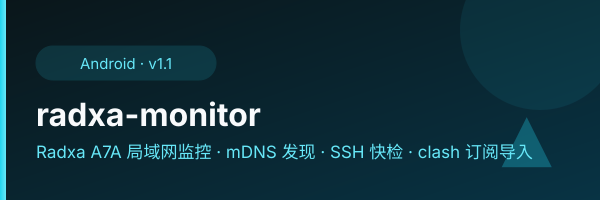

  

  

# radxa-monitor

Android 局域网监控 APK：自动发现并快检 Radxa Cubie A7A，一键导入 clash 订阅。

## 功能

- 局域网自动扫描 + mDNS 自动识别（avahi 广播 `_http._tcp`）
- SSH 快检：主机名 / 负载 / mihomo+nginx+avahi 服务状态 / 内存磁盘 / 出口 IP
- WebView 状态页 + `clash://` 一键导入订阅

## 下载

- [Releases](https://github.com/lilyco-42/radxa-monitor/releases/tag/v1.1) · v1.1（mDNS + SSH）
- 镜像：https://vless.lilyco42.top/apk

## 构建链（无 Android Studio）

aapt2 + javac(`-encoding UTF-8`) + d8（需 build-tools 36.1，34 的 d8 对 JSch 字节码 NPE）+ zipalign + apksigner；JSch 0.2.17 合入 dex；keystore `radxa.keystore`。

MD5(v1.1): `71aaab658f24f8e3740668eaf70a5778`
